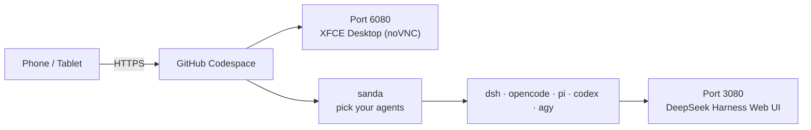

<div align="center">

# Sanda

### Your Cloud Linux Desktop & AI Coding Rig in a Browser

No PC required. Turn a phone or tablet into a full Linux workstation with AI coding agents.

[](https://github.com/M5Devs/Sanda/generate)
[](https://codespaces.new/M5Devs/Sanda)
[](LICENSE)

</div>

---

Sanda is a ready-to-use GitHub **template** that boots a GitHub Codespace containing:

- a full **XFCE Linux desktop** you open in your phone browser (noVNC on port `6080`), and
- a **`sanda` command** that installs only the AI coding agents you choose.

Boot stays fast (a few minutes) because no agent is downloaded at creation time — you pick your tools once, and they persist with the Codespace.



## What you get

| Port | Service | Label in the PORTS tab |
| ---: | --- | --- |
| `6080` | XFCE desktop streamed over noVNC | **Linux Desktop (noVNC)** |
| `3080` | DeepSeek Harness browser UI | **DeepSeek Harness Web UI** |

| Menu option | Command | Installed from |
| --- | --- | --- |
| DeepSeek Harness | `dsh`, `dsh-web`, `dsh-tui` | `@deepseek-ai/dsh` (npm) |
| OpenCode | `opencode` | `opencode-ai` (npm) |
| Pi coding agent | `pi` | `@earendil-works/pi-coding-agent` (npm) |
| OpenAI Codex CLI | `codex` | `@openai/codex` (npm) |
| Antigravity CLI | `agy` | official installer |
| Antigravity Desktop | desktop menu entry | official build (~210 MB) |

---

## Quick start (about 5 minutes, from your phone)

### 1. Tap **Use this template** — don't fork

[](https://github.com/M5Devs/Sanda/generate)

A **fork** stays public and linked to this repository, so your experiments, notes, and half-finished projects are visible to everyone.

**Use this template** creates a brand-new repository that belongs to you:

- choose **Private** — nobody can see your work,
- your own history, issues, and settings, with no upstream noise,
- still one tap to open in Codespaces.

Name it whatever you like, pick **Private**, and create it.

### 2. Add your API keys as Codespaces Secrets

Never paste keys into files. GitHub injects secrets as environment variables into every Codespace you start.

1. Open **<https://github.com/settings/codespaces>**
2. Tap **New secret**
3. Name it, paste the value, and under **Repository access** select your new Sanda repo
4. Repeat for the keys you have:

| Secret name | Used by |
| --- | --- |
| `DEEPSEEK_API_KEY` | DeepSeek Harness (`dsh`) |
| `OPENAI_API_KEY` | Codex CLI, Pi, OpenCode |
| `GEMINI_API_KEY` | Antigravity, Pi, OpenCode |
| `ANTHROPIC_API_KEY` | Pi, OpenCode |

Add the secrets **before** you start the Codespace — a running Codespace only sees secrets that existed when it started. If you add one later, stop and restart it.

> Each agent can also sign in with its own `login` command if you prefer OAuth over environment variables. Keys are optional; the desktop works without any.

### 3. Open the Codespace

[](https://codespaces.new/M5Devs/Sanda)

Pick the **2-core** machine — it is enough for the desktop and the agents, and it is what your free monthly quota covers. The first build installs the desktop, a browser, and the base tools; no AI agent is downloaded yet, so it finishes quickly.

When it finishes, the **PORTS** tab lists `6080` and `3080`.

### 4. Run `sanda` and pick your tools

In the Codespace terminal:

```bash
sanda
```

You get a checklist. Toggle only what you need with **Space**, confirm with **Enter**, and Sanda downloads just those tools:

```text
[x] DeepSeek Harness   (dsh, web UI on :3080)
[ ] OpenCode           (opencode-ai)
[x] Pi coding agent    (@earendil-works/pi-coding-agent)
[ ] OpenAI Codex CLI   (@openai/codex)
[ ] Antigravity CLI    (agy)
[ ] Antigravity Desktop app  (~210 MB download)
```

Prefer no menus? Use the same installer non-interactively:

```bash
sanda install dsh pi     # just these two
sanda --all              # every CLI agent
sanda --status           # what is installed
```

Installs persist in the Codespace, so you only do this once per Codespace. Your shell already greets you with a reminder to run `sanda`.

---

## The `sanda` command

`sanda` is a small CLI installed as `/usr/local/bin/sanda` (a symlink to `.sanda/menu.sh` in your repo). It is the only thing that installs agents, which keeps container creation fast and the setup modular.

| Command | What it does |
| --- | --- |
| `sanda` | Interactive menu: pick tools, install all, show status |
| `sanda install <tool>...` | Install named tools (`dsh opencode pi codex agy agy-desktop`) |
| `sanda --all` | Install every CLI agent |
| `sanda --status` | List which agents are installed |
| `agents` | Same list, quick shell helper |

Each install is independent: a failure prints a warning and the others continue. Node-based agents use the Node feature's npm; Antigravity comes from Google's official installer; the desktop app is downloaded from Google's release storage and added to the XFCE menu.

---

## Rocket Mode — CLI & Web UI

Best on a phone: no desktop, no mouse, just fast terminal agents.

Install what you want with `sanda`, then:

```bash
pi                    # Pi coding agent
opencode              # OpenCode
codex                 # OpenAI Codex CLI
agy                   # Google Antigravity CLI
dsh-tui               # DeepSeek Harness, terminal UI
agents                # list which agents are installed
```

### DeepSeek Harness in the browser (port 3080)

```bash
dsh-web
```

This starts the web UI on port `3080` and prints a URL. Open the **PORTS** tab, tap the globe icon next to **DeepSeek Harness Web UI**, and the UI opens in your phone browser. Keep the terminal running while you use it. The helper automatically trusts the Codespaces proxy host, so the UI works behind GitHub's forwarded URL.

### From Termux on Android

You can drive the same Codespace straight from your phone's terminal:

```bash
pkg install gh
gh auth login
gh codespace list
gh codespace ssh -c <your-codespace-name>
```

You are now in the Codespace shell and can run `sanda`, `pi`, `opencode`, `codex`, or `dsh-tui` from anywhere.

---

## Full Desktop Mode — GUI

When you want a real desktop — file manager, browser, GUI apps, drag-and-drop:

1. Open the **PORTS** tab.
2. Tap the globe icon next to **Linux Desktop (noVNC)** (port `6080`).
3. Sign in with the password **`vscode`** (change it in `.devcontainer/devcontainer.json`).
4. You land in an **XFCE** desktop with a panel, application menu, terminal, and browser.

Tips:

- Tap the noVNC sidebar to switch between **touch**, **mouse**, and **keyboard** input.
- Use the **fullscreen** button for more screen space.
- Set `VNC_RESOLUTION` (default `1440x768x16`) as a Codespaces secret or in `devcontainer.json` to change the desktop size.
- The desktop survives as long as the Codespace runs; it is not a separate machine.

> `desktop-lite` provides the VNC/noVNC plumbing and starts a bare Fluxbox session; `.sanda/setup.sh` installs XFCE and points the VNC session at it.

### Antigravity desktop app (optional)

The Antigravity **CLI** (`agy`) comes from the `sanda` menu. For the full **desktop app** inside XFCE, run `sanda` and select **Antigravity Desktop app**, or:

```bash
sanda install agy-desktop
```

It downloads the official Antigravity build for your architecture, installs it under `~/.local/opt/antigravity`, and adds it to the desktop menu. Launch it from the menu or run `antigravity --no-sandbox` in a desktop terminal.

---

## Stop the Codespace when you finish

Codespaces bills **core-hours** from your free monthly quota while a machine is running, even if you are not connected.

- Stop it from <https://github.com/codespaces> (the **⋯** menu → **Stop codespace**), or
- From Termux: `gh codespace stop -c <your-codespace-name>`

Your files, secrets, and installed agents are kept. Starting it again takes seconds. Codespaces also stop automatically after 30 minutes idle by default — you can shorten that in your [Codespaces settings](https://github.com/settings/codespaces).

---

## Troubleshooting

| Symptom | Fix |
| --- | --- |
| `sanda: command not found` | The base setup did not finish. Run `bash .sanda/setup.sh` in the terminal. |
| `pi: command not found` | Agents are on demand. Run `sanda` and select Pi. |
| An install failed | Re-run `sanda` for that tool; the npm log is at `/tmp/sanda-npm-install.log`. |
| Port `3080` shows nothing | Start `dsh-web` first — the port only exists while the server runs. |
| Desktop is black or frozen | Reload the noVNC tab, then restart the session: `sudo pkill -f Xtigervnc` (the desktop restarts itself). |
| Antigravity desktop won't start | Run `antigravity --no-sandbox` in a desktop terminal (Electron sandbox limitation in containers). |
| Build is slow or runs out of memory | Use a 4-core machine. Agents are no longer part of the build, so install only what you need. |
| Secret is missing in the shell | Secrets load at Codespace start. Stop and start the Codespace after adding one. |

## Repository layout

```text
.devcontainer/
  devcontainer.json        # Codespaces entry point: image, features, ports
.sanda/
  setup.sh                 # base provisioning: XFCE, browser, tools, aliases
  menu.sh                  # the `sanda` on-demand installer (whiptail checklist)
  antigravity-desktop.sh   # optional Antigravity desktop app installer
README.md
LICENSE
```

`devcontainer.json` stays minimal on purpose: it only describes the machine, then hands off to `.sanda/setup.sh`.

## License

[MIT](LICENSE) © 2026 M5 Dev
