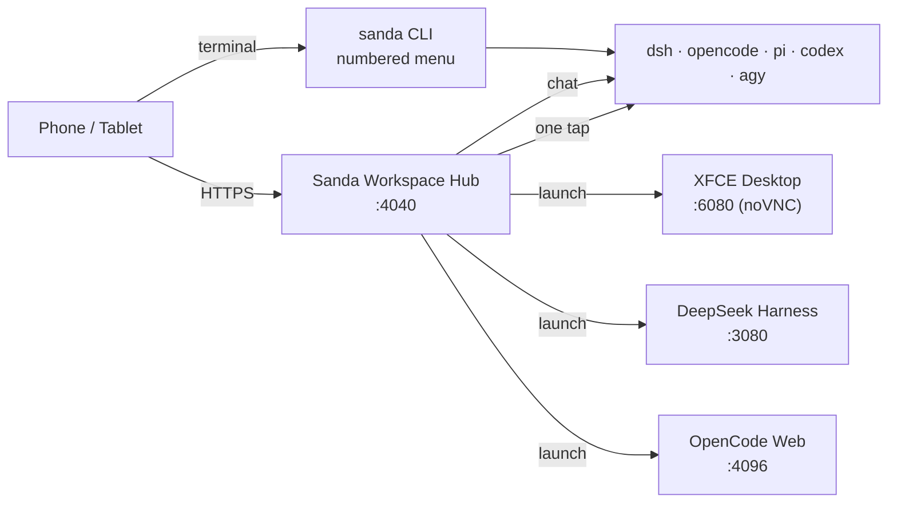

<div align="center">

# Sanda

### Your Cloud Linux Desktop & AI Coding Rig in a Browser

No PC required. Turn a phone or tablet into a full Linux workstation with AI coding agents.

[](https://codespaces.new/M5Devs/Sanda)
[](LICENSE)

</div>

---

Sanda boots a Codespace with three ways to work:

- **Sanda Workspace Hub** (port `4040`) — a mobile-first web control center: install agents, chat with them, start their web UIs, open the desktop, run quick commands. No terminal, no arrow keys.
- **`sanda` CLI** — a plain numbered menu, built for phone keyboards.
- **XFCE desktop** (port `6080`) — a full Linux desktop with a dark theme and ready-made icons.

Boot stays fast (a few minutes) because no AI agent is downloaded at creation time.



## What you get

| Port | Service | Label in the PORTS tab |
| ---: | --- | --- |
| `4040` | Sanda Workspace Hub — the mobile control center | **Sanda Dashboard** |
| `6080` | XFCE desktop streamed over noVNC | **Linux Desktop (noVNC)** |
| `3080` | DeepSeek Harness browser UI | **DeepSeek Harness Web UI** |
| `4096` | OpenCode v2 web UI (prints a login password) | **OpenCode Web** |

| Menu option | Command | Installed from |
| --- | --- | --- |
| DeepSeek Harness | `dsh`, `dsh-web`, `dsh-tui` | `@deepseek-ai/dsh` (npm) |
| OpenCode v2 | `opencode` | `@opencode/cli` (npm) |
| Pi coding agent | `pi` | `@earendil-works/pi-coding-agent` (npm) |
| OpenAI Codex CLI | `codex` | `@openai/codex` (npm) |
| Antigravity CLI | `agy` | official installer |
| Antigravity Desktop | desktop menu entry | official build (~210 MB) |

---

## Quick start (about 5 minutes, from your phone)

### 1. Pick the copy you want to work in

Work on Sanda directly, or keep your own private space: fork it or create a
repository from it in GitHub, then open the Codespace from that copy. A private
copy keeps your work, history and settings out of sight.

### 2. Add your API keys as Codespaces Secrets

Never paste keys into files. GitHub injects secrets as environment variables into every Codespace you start.

1. Open **<https://github.com/settings/codespaces>**
2. Tap **New secret**
3. Name it, paste the value, and under **Repository access** select your new Sanda repo
4. Repeat for the keys you have:

| Secret name | Used by |
| --- | --- |
| `DEEPSEEK_API_KEY` | DeepSeek Harness (`dsh`) |
| `OPENAI_API_KEY` | Codex CLI, Pi, OpenCode |
| `GEMINI_API_KEY` | Antigravity, Pi, OpenCode |
| `ANTHROPIC_API_KEY` | Pi, OpenCode |

Add the secrets **before** you start the Codespace — a running Codespace only sees secrets that existed when it started. If you add one later, stop and restart it.

> Each agent can also sign in with its own `login` command if you prefer OAuth over environment variables.

### 3. Open the Codespace

[](https://codespaces.new/M5Devs/Sanda)

Pick the **2-core** machine — enough for the desktop and the agents, and it is what your free monthly quota covers.

The first build installs the desktop, a browser, and the base tools. No AI agent is downloaded yet, so it finishes quickly. The **PORTS** tab then lists `4040`, `6080`, `3080`, and `4096`, and the workspace hub opens in a browser tab automatically.

### 4. Install your tools from the workspace hub

Open **Sanda Dashboard** (port `4040`) — or tap the globe icon next to it in the **PORTS** tab — then:

- tap **Install** on any tool and watch its output stream live,
- type a prompt in **Mobile agent chat** and read the answer without a terminal,
- tap **Start** on DeepSeek Harness or OpenCode Web and the matching port lights up,
- tap **Linux Desktop** to jump into the GUI.

That is the whole setup. Prefer a terminal? Run `sanda`.

---

## The Sanda Workspace Hub (port `4040`)

The hub is a zero-dependency Node server (`.sanda/web/server.js`) that starts automatically with every Codespace and is designed for a phone screen: dark, large touch targets, no keyboard shortcuts, no horizontal scrolling.

**AI coding tools** — a status badge (**Installed** / **Not installed**) for `dsh`, `opencode`, `pi`, `codex`, `agy`, and `antigravity-desktop`. Each missing tool gets a big **Install** button that runs the same installer as `sanda` and streams stdout/stderr into the log panel over server-sent events.

**Launch** — one card per thing you can open, with a live **running / stopped** badge:

| Card | What the button does |
| --- | --- |
| **Linux Desktop** (`6080`) | Opens noVNC in a new tab |
| **DeepSeek Harness** (`3080`) | **Start** runs `dsh-web` in the background, then **Open**, **Stop** and **Restart** appear |
| **OpenCode Web** (`4096`) | **Start** runs `opencode serve`, then shows the login **password** with a copy button |
| **Antigravity Desktop** | **Launch** starts the GUI app on the desktop display (`:1`); **Stop** closes it |

**Stop** and **Restart** appear on a card as soon as its service is running.
Each service the hub starts records its pid in `/tmp/sanda-<service>.pid`, so
**Stop** ends the whole process group (the Electron helpers included) and
**Restart** stops then starts it again. Starting is idempotent: a double tap, or
a second browser tab, cannot spawn a second copy — the hub waits until the port
answers before it reports the service as up. A service you started yourself in a
terminal has no pidfile, so **Stop** tells you to end it from there instead of
guessing which process to kill.

Links are built from the Codespaces hostname (`<name>-4040.app.github.dev` → `<name>-6080.app.github.dev`), or `localhost` when you run it locally.

**Mobile agent chat** — pick **Pi** or **Codex**, type a prompt, tap **Send**, and the answer streams into the page as bubbles. This is the fastest path from a phone: no terminal, no tmux, no arrow keys. `Ctrl`/`Cmd`+`Enter` sends from a hardware keyboard; on a phone just tap **Send**.

The chat is **sessionful**: the header shows *continuing chat* once a session
exists, and every later message continues it (`pi --session-id …`,
`codex exec resume …`). Tap **⟲ New chat** to forget the session and start fresh.
The session id is kept in `/tmp/sanda-chat/`, so it survives a page reload but
not a Codespace rebuild.

**Quick command** — a text field plus chips (`sanda --status`, `sanda web`, `ls -la`, `git status`, `df -h`) that run in the workspace and print the result.

| Endpoint | Purpose |
| --- | --- |
| `GET /api/status` | tool badges, ports, running services, OpenCode password |
| `GET /api/ports` | which of the tracked ports are listening |
| `POST /api/install` | start `sanda install <tool>` |
| `GET /api/jobs/<id>/events` | live install or chat output (SSE) |
| `POST /api/chat` | run `pi -p` or `codex exec`, resuming that agent's session |
| `POST /api/chat/reset` | forget the stored session (the **New chat** button) |
| `POST /api/exec` | run one shell command |
| `POST /api/start-dsh` | start the DeepSeek web UI on `3080` |
| `POST /api/start-opencode` | start `opencode serve` on `4096` |
| `POST /api/start-antigravity` | launch the Antigravity desktop app |
| `POST /api/stop-<service>` | stop a service the hub started (`dsh`, `opencode`, `antigravity`) |
| `GET /api/health` | liveness probe used by the launcher |

Mutating requests must be `application/json` and come from the hub's own origin
(`<codespace>-4040.app.github.dev`, `githubpreview.dev`, or `localhost`).
`/api/status` is checked the same way because it returns the OpenCode password.

The server listens on `0.0.0.0` so the Codespaces proxy can reach it. Only the hub's own origin is trusted: a foreign site, another Codespace, or another port of this Codespace (the desktop, an agent UI) cannot read the status payload or drive the API. Keep the port visibility **Private** (the default) — the hub can run commands as you.

Restart it any time with:

```bash
bash .sanda/web/start.sh      # idempotent; exits if already healthy
tail -f /tmp/sanda-web.log    # server log
```

`start.sh` finds `node` even when the shell has not loaded nvm (the usual cause of a `502 Bad Gateway` on port `4040`), waits for `/api/health`, and prints the server log if startup fails.

---

## The `sanda` command

`sanda` is installed as `/usr/local/bin/sanda` (a symlink to `.sanda/menu.sh`). The interactive menu is a **plain numbered list**, because mobile keyboards have no arrow keys:

```text
[sanda]  What do you want to install?

    1) DeepSeek Harness      (dsh, web UI on :3080)
    2) OpenCode v2           (@opencode/cli, web UI on :4096)
    3) Pi coding agent       (@earendil-works/pi-coding-agent)
    4) OpenAI Codex CLI      (@openai/codex)
    5) Antigravity CLI       (agy)
    6) Antigravity Desktop   (~210 MB download)

  a) install all CLI agents
  w) start the dashboard (port 4040)
  s) show installed tools
  q) quit

Numbers separated by spaces (e.g. 1 3), or a/w/s/q:
```

Type `1 3` and press Enter to install DeepSeek Harness and Pi. A `✓` marks what is already installed.

| Command | What it does |
| --- | --- |
| `sanda` | Numbered menu |
| `sanda install <tool>...` | Install named tools (`dsh opencode pi codex agy agy-desktop`) |
| `sanda --all` | Install every CLI agent |
| `sanda --status` | List which agents are installed |
| `sanda web` | Start (or check) the workspace hub on `4040` |
| `agents` | Same list, quick shell helper |

Each install is independent: a failure prints a warning and the others continue.

---

## Rocket Mode — CLI & Web UI

Best on a phone: no desktop, no mouse, just fast terminal agents.

Install what you want (dashboard or `sanda`), then:

```bash
pi                    # Pi coding agent
opencode              # OpenCode v2 (TUI)
codex                 # OpenAI Codex CLI
agy                   # Google Antigravity CLI
dsh-tui               # DeepSeek Harness, terminal UI
agents                # list which agents are installed
```

### DeepSeek Harness in the browser (port 3080)

Tap **Start** on the hub, or run:

```bash
dsh-web
```

This starts the web UI on port `3080` and prints a URL. Open the **PORTS** tab, tap the globe icon next to **DeepSeek Harness Web UI**, and the UI opens in your phone browser. Keep the terminal running while you use it. The helper automatically trusts the Codespaces proxy host, so the UI works behind GitHub's forwarded URL.

The first request needs the one-time token from that URL (`?token=…`); the hub's **Open** button appends it for you. Opening the port by hand? Copy the full URL from `/tmp/sanda-dsh-web.log`.

### OpenCode Web (port 4096)

Tap **Start** on the hub, or run:

```bash
opencode serve --port 4096 --hostname 0.0.0.0
```

OpenCode v2 prints a **login password** the first time it starts. The hub reads it from the log and shows it on the OpenCode card with a copy button — paste it into the OpenCode tab and you are in. The hub also passes `--cors` for your forwarded URL when it runs inside Codespaces.

### From Termux on Android

You can drive the same Codespace straight from your phone's terminal:

```bash
pkg install gh
gh auth login
gh codespace list
gh codespace ssh -c <your-codespace-name>
```

You are now in the Codespace shell and can run `sanda`, `pi`, `opencode`, `codex`, or `dsh-tui` from anywhere.

---

## Full Desktop Mode — GUI

When you want a real desktop — file manager, browser, GUI apps, drag-and-drop:

1. Tap **Linux Desktop** on the dashboard, or open the **PORTS** tab and tap the globe icon next to **Linux Desktop (noVNC)** (port `6080`).
2. Sign in with the password **`vscode`** (change it in `.devcontainer/devcontainer.json`).
3. You land in a dark **XFCE** desktop with a panel, application menu, terminal, and browser.

The desktop is set up to be useful immediately:

| Icon on the desktop | What it does |
| --- | --- |
| **Sanda Dashboard** | Opens `http://localhost:4040` in the browser |
| **Sanda Terminal** | Maximised `xfce4-terminal` with `Monospace 13` |
| **Google Chrome** | The container browser (falls back to Chromium if needed) |
| **Workspace** | Opens the project folder in Thunar |

Theme and fonts: `Adwaita-dark`, 11 pt UI font, dark terminal palette.

Tips:

- Tap the noVNC sidebar to switch between **touch**, **mouse**, and **keyboard** input.
- Use the **fullscreen** button for more screen space.
- Set `VNC_RESOLUTION` (default `1440x768x16`) as a Codespaces secret or in `devcontainer.json` to change the desktop size.

> `desktop-lite` provides the VNC/noVNC plumbing and starts a bare Fluxbox session; `.sanda/setup.sh` installs XFCE, applies the theme, and points the VNC session at it.

### Antigravity desktop app (optional)

The Antigravity **CLI** (`agy`) comes from the menu. For the full **desktop app** inside XFCE, pick option **6** in `sanda`, tap **Install** on the dashboard, or:

```bash
sanda install agy-desktop
```

It downloads the official Antigravity build for your architecture, installs it under `~/.local/opt/antigravity`, and adds it to the desktop menu. Launch it from the menu or run `antigravity --no-sandbox` in a desktop terminal.

---

## Stop the Codespace when you finish

Codespaces bills **core-hours** from your free monthly quota while a machine is running, even if you are not connected.

- Stop it from <https://github.com/codespaces> (the **⋯** menu → **Stop codespace**), or
- From Termux: `gh codespace stop -c <your-codespace-name>`

Your files, secrets, and installed agents are kept. Starting it again takes seconds. Codespaces also stop automatically after 30 minutes idle by default — you can shorten that in your [Codespaces settings](https://github.com/settings/codespaces).

---

## Troubleshooting

| Symptom | Fix |
| --- | --- |
| **`502 Bad Gateway` on port `4040`** | The hub process is not listening (usually a Codespace restart). Run `bash .sanda/web/start.sh` — it finds `node` without nvm, starts the server, and prints the log if it fails. Then reload the tab. |
| Dashboard does not load | Run `bash .sanda/web/start.sh`, then check `/tmp/sanda-web.log`. |
| Dashboard loads but shows "dashboard offline" | The server was restarted; reload the page. |
| An Install button stalls | The log panel shows the error; npm detail is in `/tmp/sanda-npm-install.log`. |
| `sanda: command not found` | The base setup did not finish. Run `bash .sanda/setup.sh`. |
| `pi: command not found` | Agents are on demand. Install it from the hub or `sanda`. |
| Port `3080` shows nothing | Tap **Start** on the hub, or run `dsh-web`; check `/tmp/sanda-dsh-web.log`. |
| Port `4096` shows nothing | Tap **Start** on the OpenCode card; check `/tmp/sanda-opencode.log`. |
| OpenCode asks for a password | Read it from the OpenCode card (copy button) or `grep -i password /tmp/sanda-opencode.log`. |
| Chat says "not installed yet" | Install that agent in **AI coding tools** first. |
| Chat forgets the earlier messages | Check the header: after **⟲ New chat**, or a Codespace rebuild, the next message starts a new session. |
| Stop says the service was started outside the hub | It was launched from a terminal, so it has no pidfile. Stop it there (`pkill -f "dsh web"`, `pkill -f "opencode serve"`, `pkill -f antigravity`). |
| Agent replies with a login error | Add the API key as a Codespaces secret, or run the agent's own `login` command once. |
| Desktop is black or frozen | Reload the noVNC tab, then restart the session: `sudo pkill -f Xtigervnc` (the desktop restarts itself). |
| Desktop icons are missing | Run `bash .sanda/setup.sh` again, then restart the desktop. |
| Antigravity desktop won't start | Run `antigravity --no-sandbox` in a desktop terminal (Electron sandbox limitation in containers). |
| Build is slow or runs out of memory | Use a 4-core machine. Agents are not part of the build, so install only what you need. |
| Secret is missing in the shell | Secrets load at Codespace start. Stop and start the Codespace after adding one. |

## Repository layout

```text
.devcontainer/
  devcontainer.json        # Codespaces entry point: image, features, ports, hooks
.sanda/
  setup.sh                 # base provisioning: XFCE, browser, tools, theme, icons
  menu.sh                  # the `sanda` CLI (numbered menu, no TUI deps)
  antigravity-desktop.sh   # optional Antigravity desktop app installer
  web/
    server.js              # zero-dependency dashboard API + static server
    start.sh               # idempotent launcher used by postStartCommand
    public/                # index.html, styles.css, app.js (mobile-first UI)
.github/
  workflows/ci.yml         # bash -n, node --check, shellcheck, JSON check
README.md
LICENSE
```

`devcontainer.json` stays minimal on purpose: it describes the machine, then hands off to `.sanda/setup.sh` (create) and `.sanda/web/start.sh` (every start).

## License

[MIT](LICENSE) © 2026 M5 Dev
